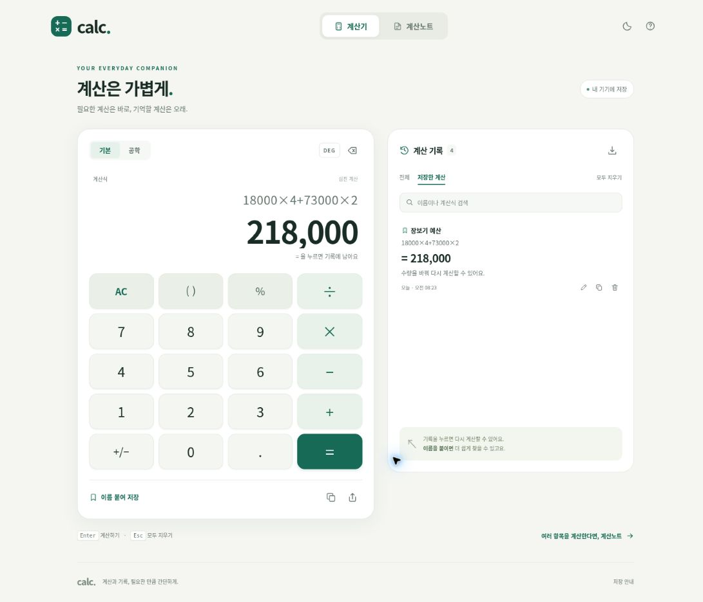

# calc

빠르게 계산하고, 기록을 다시 꺼내 보고, 항목을 고쳐 쓰는 한국어 계산기입니다.

| 항목 | 내용 |
| --- | --- |
| 배포 주소 | [softm.github.io/calc](https://softm.github.io/calc/) |
| 저장소 | [softm/calc](https://github.com/softm/calc) |
| 개인정보처리방침 | [softm.github.io/calc/privacy.html](https://softm.github.io/calc/privacy.html) |
| 실행 방식 | 빌드 과정과 런타임 의존성이 없는 HTML·CSS·JavaScript ES modules |
| 데이터 | 계산 기록과 노트를 현재 브라우저에 저장 |
| 설치 | 브라우저에서 바로 사용하며, 지원하는 환경에서는 홈 화면에 추가 가능 |

## 사용

배포 주소를 열면 바로 계산할 수 있습니다. 사용하는 분이 서버를 설치하거나 명령어를 실행할 필요는 없습니다.

- 기본·사무·공학 모드에서 숫자판이나 키보드로 계산합니다.
- 사무 모드에서 메모리(MC/MR/M+/M−), 누적 합계(GT), 목표 매출이익률(MU), 00, 제곱근을 사용합니다.
- 화이트·차콜·크림·핑크 테마를 고르고 모바일에서는 계산 기록을 펼쳐 볼 수 있습니다.
- 계산 기록에서 이전 계산을 다시 확인합니다.
- 계산노트에 항목·수량·단가를 남기고, 값을 바꾸며 합계를 확인합니다.
- 계산 결과와 내역을 복사하거나 기기에서 제공하는 공유 기능으로 전달합니다.
- 처음 온라인으로 연 뒤 앱 자원 저장이 완료되면 오프라인에서도 사용할 수 있습니다.

공유·설치 버튼의 제공 여부는 사용하는 브라우저와 기기에 따라 달라질 수 있습니다.

## 계산 규칙

기본 사칙연산은 유리수를 사용하는 계산 엔진으로 처리합니다. 입력한 유한소수를 일반적인 이진 부동소수점 값으로 바로 바꾸지 않으므로, 예를 들어 0.1 + 0.2는 0.3으로 계산합니다.

삼각함수 등 일반적인 유리수로 표현할 수 없는 계산에는 근삿값을 사용합니다. 결과를 화면에 표시할 때는 표시 자릿수에 맞게 정리할 수 있습니다.

퍼센트(%)의 해석은 모드에 따라 다릅니다. **기본·공학 모드**는 수학식처럼 100으로 나누고, **사무 모드**는 덧셈과 뺄셈 끝에 붙은 퍼센트를 앞 금액에 대한 증감률로 계산합니다.

| 계산식 | 기본·공학 | 사무 |
| --- | ---: | ---: |
| `10%` | 0.1 | 0.1 |
| `200 + 10%` | 200.1 | 220 |
| `200 − 10%` | 199.9 | 180 |
| `200 × 10%` | 20 | 20 |
| `200 + 10% − 10%` | 200 | 198 |

사무 모드에서 **M+ / M−**는 표시값을 메모리에 더하거나 빼고, **MR**은 불러오며 **MC**는 지웁니다. **GT**는 사무 모드에서 `=`로 확정한 계산의 누적 합계를 조회합니다. `GT 초기화`는 누적 합계만 지우고 계산 기록은 보존합니다. **MU**는 `원가 ÷ 목표 매출이익률` 뒤에 누르면 매출이익률 기준 판매가를 구합니다. 예: `100 ÷ 20` + MU → 125 (20% 마진). 일반적인 원가 가산율(markup)과 구분해야 합니다.

모드는 계산기 상단에서 전환합니다. 계산 기록에는 모드가 저장되어 불러왔을 때 동일한 계산 규칙을 사용합니다. 계산노트는 기존의 수학적 퍼센트 규칙을 유지합니다.

## 저장과 개인정보

계산은 기기 안에서 처리합니다. 계산을 위해 외부 API로 식이나 결과를 보내지 않으며, 로그인과 서버 데이터베이스를 사용하지 않습니다.

기록과 노트는 현재 브라우저의 로컬 저장소에 남습니다. 다른 브라우저나 기기와 자동으로 동기화되지 않으며, 브라우저의 사이트 데이터를 지우면 저장한 내용도 삭제될 수 있습니다. 공유한 내용은 사용자가 선택한 앱이나 대상에게 전달됩니다.

웹과 모바일 앱에 적용되는 전체 방침은 [개인정보처리방침](privacy.html)에서 확인할 수 있습니다.

웹에서는 화면 하단에 접기·펼치기 가능한 카카오 AdFit 배너 한 개를 표시합니다. 돌봄한눈의 하단 광고 UX를 참고하여 접힘 선택을 같은 탭에서 유지하고, 계산식·노트를 입력하면 자동으로 접어 사용자가 다시 펼칠 때까지 입력 공간을 확보합니다. 광고와 본문을 별도 영역으로 배치하여 키패드를 가리지 않으며 광고 미수신·차단·실패 시 빈 공간을 반환합니다. Android 앱은 웹 배너를 차단하고 네이티브 Google AdMob 적응형 배너를 사용하므로 광고가 중복되지 않습니다. 계산식·결과·계산 노트는 광고 사업자에게 전달하지 않습니다. 광고 운영 원칙과 식별자는 [광고 운영 계획](docs/ADS.md)에 정리되어 있습니다.

이름 없는 계산 기록은 최근 200개를 보관합니다. 이름과 메모를 붙인 계산은 최대 1,000개까지 저장하며 자동 정리에서 제외합니다. 저장 공간이 부족하거나 브라우저가 저장을 제한하면 화면에 알리고, 현재 기록을 내보낼 수 있습니다.

## 개발 환경

아래 명령어는 소스를 수정하는 개발자를 위한 것입니다. 제품 사용에는 필요하지 않습니다.

Node.js 20 이상을 사용합니다. 의존성 설치나 빌드 명령은 필요하지 않습니다.

~~~sh
npm test
npm run check
~~~

- npm test: Node.js 기본 테스트 러너로 계산 엔진 등의 동작을 검증합니다.
- npm run check: JavaScript 구문, 실제 정적 파일 참조, GitHub Pages 하위 경로, manifest와 PNG 크기, 오프라인 캐시 목록을 검사합니다.

로컬 브라우저 확인은 저장소 폴더에서 정적 HTTP 서버를 실행합니다. ES modules와 서비스 워커를 사용하므로 HTML 파일을 직접 더블클릭하는 방식 대신 HTTP 주소로 접속합니다.

~~~sh
python3 -m http.server 8000
~~~

접속 주소: [localhost:8000](http://localhost:8000/)

GitHub Pages와 같은 하위 경로까지 확인하려면 저장소의 부모 폴더에서 서버를 실행한 뒤 [localhost:8000/calc/](http://localhost:8000/calc/)를 엽니다. 이 경우 저장소 폴더 이름이 calc여야 합니다.

## GitHub Pages 배포

[저장소의 Pages 설정](https://github.com/softm/calc/settings/pages)에서 다음과 같이 지정합니다.

| 설정 | 값 |
| --- | --- |
| Source | Deploy from a branch |
| Branch | main |
| Folder | / (root) |

정적 파일이 저장소 루트에 있으므로 빌드 출력 폴더를 별도로 지정하지 않습니다. 배포 주소는 [https://softm.github.io/calc/](https://softm.github.io/calc/)입니다.

모든 앱 자원은 상대 경로를 사용하고, manifest의 id·start_url·scope는 ./입니다. 다른 GitHub Pages 프로젝트의 루트 경로와 섞이지 않도록 유지합니다. .nojekyll 파일은 정적 자원을 Jekyll 변환 없이 제공하기 위해 포함합니다.

## 오프라인과 업데이트

서비스 워커는 자신의 앱 범위에서 사용하는 명시적인 자원 목록만 저장합니다. 다른 프로젝트의 캐시와 외부 사이트 요청은 처리하지 않습니다.

| 대상 | 방식 |
| --- | --- |
| 앱 첫 화면과 정적 자원 | 현재 활성화된 동일 버전의 캐시 우선 |
| 새 서비스 워커 설치 | 이전 HTTP 캐시를 재사용하지 않고 새 자원 전체를 받아 별도 버전으로 저장 |
| 새 버전 전환 | 자동 강제 새로고침 없이 대기, 사용자가 업데이트를 선택하면 화면과 자원을 함께 전환 |
| 캐시를 읽을 수 없는 경우 | 온라인 응답으로 복구 시도, 연결도 실패하면 첫 화면에 재접속 안내 |

일반 탐색 요청으로 현재 버전의 HTML이나 JavaScript 캐시를 덮어쓰지 않습니다. 따라서 새 배포가 올라와도 업데이트를 적용하기 전에는 기존 HTML과 기존 스크립트를 함께 사용합니다. 필요한 자원 중 하나라도 새로 받지 못하면 새 서비스 워커 설치가 실패하고, 기존 버전은 계속 사용할 수 있습니다.

서비스 워커는 앱 첫 화면의 경로와 목록에 적힌 정적 파일만 처리합니다. 다른 프로젝트나 이 앱에 존재하지 않는 하위 페이지를 앱 첫 화면으로 대체하지 않습니다.

오프라인 자원을 변경할 때는 sw.js의 CACHE_VERSION 값을 올립니다. 파일을 추가하거나 이름을 바꿨다면 PRECACHE_ASSETS 목록도 함께 수정하고 npm run check로 누락 여부를 확인합니다.

앱은 대기 중인 서비스 워커에 { type: 'SKIP_WAITING' } 메시지를 보내 새 버전을 적용할 수 있습니다. 최초 설치 때 발생하는 controllerchange만으로 페이지를 다시 불러오지 않도록, 사용자가 업데이트를 수락한 경우에만 새로고침해야 합니다.

배포 후에는 실제 주소에서 화면 표시, 기록 저장, 계산 노트, 공유·복사, 오프라인 재접속을 확인합니다. 새 파일을 올렸는데 이전 화면이 유지되면 새 버전 알림을 확인하고, 개발 중의 캐시 초기화는 브라우저 개발자 도구에서 수행합니다.

## 주요 파일

| 파일 | 역할 |
| --- | --- |
| index.html · styles.css · app.js | 화면과 계산기 상호작용 |
| engine.js | 계산식 처리와 숫자 계산 |
| input.js | 커서 위치·부호 전환·결과 이어 계산 |
| notes.js · notes.css | 계산 노트 |
| manifest.webmanifest · icons/ | 설치 정보와 앱 아이콘 |
| sw.js | 오프라인 자원과 업데이트 |
| adfit-config.js · adfit.js · adfit.css | 웹 AdFit 하단 접힘 광고 설정·생명주기·화면 영역 분리 |
| docs/ADS.md | 광고 배치·개인정보·검증 계획 |
| tests/ | 자동 테스트 |
| tools/check-site.mjs | 정적 사이트 배포 전 검사 |
| tools/responsive-preview.html | 개발 중 화면 너비별 배치 확인 |
